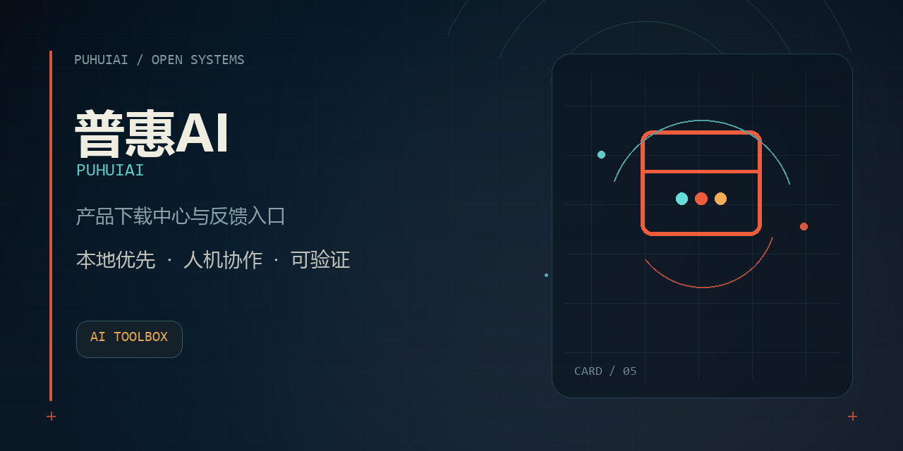

# 普惠AI · AI Agent 与本地效率工具

独立开发者汪君，专注 AI Agent、提示词工程和隐私优先的本地工具。

## 产品

| 产品 | 作用 | 平台 |
|:---|:---|:---|
| [猫盾 Maodun](https://github.com/puhuiai/maodun) | AI Agent 规范监视、权限管控与行为记录 | Windows |
| [普惠AI 指令拆解引擎](https://github.com/puhuiai/puhuiai-fanrenge) | 中文需求拆解、提示词与 AI 工作流生成 | Windows / CLI |
| [拦接宝 LanJieBao](https://github.com/puhuiai/lanjiebao) | 来电拦截、AI 留言与号码归属地 | Android |
| [龙虾 Pro](https://github.com/puhuiai/lobsterpro3) | 连接大模型与本地工具的 AI Agent 工作台 | Windows |
| [EveryMatch](https://github.com/puhuiai/everymatch) | 多智能体任务总控台：一句话拆步骤、按能力选 Agent、执行与独立验收 | Windows |

全部产品与下载入口：[**普惠AI 产品中心**](https://puhuiai.github.io/website/)

## 方向

- AI Agent 可观测、授权与安全边界
- 中文提示词工程与任务拆解
- 本地优先、数据不过度上传的工具
- 把复杂 AI 能力做成普通用户能直接使用的产品

## 反馈

请在产品对应的 GitHub 仓库提交 Issues。商业合作与授权请访问 [puhuiai.com.cn](https://puhuiai.com.cn)。

---

Built and maintained by 汪君 · 普惠AI
